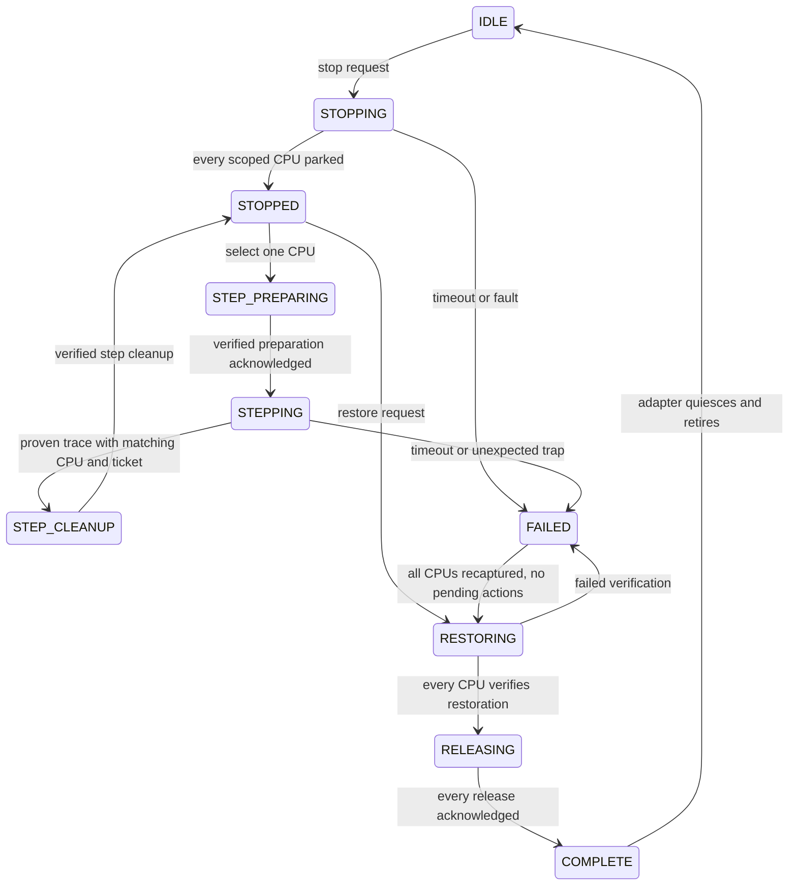

# SMP kernel execution coordinator

The [coordinator](../residents/execution/control.h) and
[mailbox](../residents/execution/mailbox.h) implement a portable stop/step/restore
protocol. Host tests drive concurrent calls from 16 simulated CPUs. Live CPU
rendezvous, architecture stepping, physical transport and hardware restoration
still need a resident adapter and console validation. The kernel-offset payload
remains inspection-only.

## Stop, step and restoration barriers



Every concurrent entry makes one strong, lock-free 32-bit CAS attempt. Contention
returns `KD_BUSY`; no core function spins, allocates, performs I/O, takes a
sleeping lock or calls an adapter under the gate. Fixed loops cover at most
16 CPUs. Initialization/retirement require platform quiescence. Acquire/release
publication follows the [compiler atomic contract](https://gcc.gnu.org/onlinedocs/gcc/_005f_005fatomic-Builtins.html);
the compiler rejects targets without always-lock-free 32-bit atomics.

`kd_enter` means a CPU surrendered its interrupted context to the resident park
loop. STOPPED requires every independently established CPU in scope to arrive.
Duplicate, stale or excluded-CPU arrivals cannot complete the barrier. The live
adapter must establish a fixed actual online CPU set; a convenient subset is
not a whole-kernel stop.
On a busy arrival, the adapter must retain the context inside its resident
entry and retry; `KD_BUSY` is not permission to resume target execution.

`kd_cpu_poll` issues one pending action per CPU. The adapter executes it outside
the gate and acknowledges the exact epoch, ticket and context cookies with
`kd_cpu_ack`. On `KD_BUSY`, retain the action and retry the acknowledgement,
without repeating the hardware operation. Nested polls do not reissue it.
PREPARE_STEP and RELEASE_CPU perform preparation/preflight first; the adapter
must not execute the instruction or return to the target unless the subsequent
acknowledgement returns `KD_OK`.
Successful PREPARE_STEP acknowledgement authorizes one selected CPU to execute;
all other target contexts stay parked. Abort or timeout before acknowledgement
prevents execution even if preparation already changed instrumentation.

Only a proven trace from the same CPU and step ticket enters step cleanup.
DR6 alone is insufficient. Unexpected owned traps become failures. A verified
CLEAN_STEP is required before another step or register query. Requests spend a
finite per-stop budget of 1–4096, including failed preparation attempts. This
core programs no DR slot; the adapter must preserve all four shared slots and
their ownership.
Successful CLEAN_STEP acknowledgement must include the cleaned frame readback.
The core refreshes its register snapshot from it and rejects changes to post-step
GP values. The adapter additionally verifies the exact expected flag changes,
including preservation of arithmetic flags; those architecture semantics are
outside this coordinator.

No CPU receives release authorization until **every scoped CPU verifies
restoration**. Failed readback leaves CPUs held and records the first fault.
Explicit retry rechecks all CPUs. Restore debugger-owned instrumentation and
control state while preserving the instruction's post-step GP registers and
arithmetic flags; rewinding the entire original frame would undo the step.

COMPLETE records release acknowledgements, not proof that IRET completed or the
target progressed. The adapter independently verifies release, quiesces handlers
and transport, then calls `kd_retire`. Fault after partial release leaves an
unknown execution state; restoration cannot restart while a release is recorded.

## Deadlines and adapter obligations

Deadlines use a platform-supplied monotonic, CPU-consistent clock and must fit
the pinned `max_hold_ticks` bound. Step deadlines cannot extend the current
lease. Backwards time is refused. Expiry marks failure; it cannot manufacture a
parked CPU. `need_stop_mask` identifies missing/stepping CPUs requiring a real
recapture before restoration. An explicit fresh restore deadline permits cleanup
after timeout, retaining the first fault. Once all-CPU restoration commits
release, lease expiry does not split that commit. Release failure still faults.

The hardware adapter must provide pinned build/session/generation, exclusive
ownership, actual CPU membership and the four declared capabilities. These
fields are trusted input, not evidence generated by the core. Context cookies
must pin the full architecture state and undo ledger, beyond the GP observation
struct. Current and original cookies accompany each action.

Instruction preflight and stepping must be bounded: an instruction can wait on
a lock owned by a parked peer or change interrupt/exception state. Setting TF
alone does not establish safe kernel stepping. Unsupported instructions must be
refused. Trap chaining, resident emulation, fault-contained writes, barriers,
readback and rollback remain adapter operations. `verified=1` asserts those
operations succeeded; the core cannot independently perform them. Preserve
foreign DR state. No PCB, IDT or TSS writer is supplied or authorized here.

A local watchdog must remain usable if a CPU never arrives, a step never returns,
the controller disappears or restoration fails. `kd_fault` reports such failures
without a client command. Deadlines bound acceptance, not hardware execution
time. The core never releases an unrestored target, so failure can require
platform intervention. Code/data must be wired and coherent, with resident-safe
memory-copy routines; SDK compilation does not make userland libc suitable for
a kernel park loop. The earlier capture component still needs its own
serialization when used alongside this coordinator.

These missing platform pieces prevent claiming a validated SMP-safe kernel
debugger. The [recovery constraints](DEBUGGER_RECOVERY.md) remain in force.

## Polled mailbox and offline host codec

The mailbox contains one 64-byte request and one 240-byte reply in coherent RAM.
CAS ownership plus release/acquire publication prevents torn payload access.
An unfinished transaction cannot be overwritten. A busy coordinator returns the
same request to READY; timeout does not authorize resetting shared memory or
resending a mutation.

ABI 1 uses fixed-width native little-endian records with compile-time sizes;
the host codec serializes explicitly. Requests carry ABI/size, operation/CPU,
session words, command sequence, stop epoch, deadline and argument. Operations
are status, stop, registers, step, restore and abort. Stop's argument is the step
budget; unused fields must be zero. Replies carry identity, state/result,
parked/restored/released/recapture masks, first fault, selected CPU/ticket,
budget usage and optional GP registers. Only a successful register query while
STOPPED supplies GP values. Errors are ABI `kd_error` values, not native errno.
Exact last-command replay returns a cached reply without repeating a side
effect; a new status command obtains current state. Changed, old or skipped
sequences are refused.

This mailbox makes no socket or syscall calls, but supplies **no physical link**.
A reviewed polled device or externally accessible shared-memory bridge must let
the host publish while console scheduling is stopped. A userland TCP worker on
a parked CPU cannot do that. Session words identify transactions; access control
and authentication belong to the bridge.

The [host codec](../host/kernel_control.py) reads/writes saved records only.
Example JSON with illustrative session and console-clock values:

```json
{"operation":"stop","session":[11,22],"sequence":1,"epoch":0,"deadline":1000,"argument":32}
```

```sh
python3 host/kernel_control.py encode --request request.json --output request.bin
python3 host/kernel_control.py decode --reply reply.bin
```

Encoding refuses to overwrite an existing file. These commands do not connect,
submit requests, authenticate observations or establish live readiness.

## ps5debug-NG comparison

Reviewed commit `938d1a735018073844dc2d8f69fea25f2a8aaa4b` on 2026-10-19.
Its [stepping implementation](https://github.com/Pharaoh2k/ps5debug-NG/blob/938d1a735018073844dc2d8f69fea25f2a8aaa4b/debugger/source/debug.c#L1265)
uses process/LWP ptrace. Its [kernel dispatch](https://github.com/Pharaoh2k/ps5debug-NG/blob/938d1a735018073844dc2d8f69fea25f2a8aaa4b/debugger/source/kern.c)
provides base/read/write commands. That architecture does not supply this
backend's all-CPU rendezvous or transport while the kernel is parked. The
[PCB register writer](https://github.com/Pharaoh2k/ps5debug-NG/blob/938d1a735018073844dc2d8f69fea25f2a8aaa4b/debugger/source/kern_dbreg.c#L140)
conflicts with this repository's retired-fallback constraints and was not
imported. This mailbox ABI is separate from its TCP protocol. No upstream code
was copied or deployed; upstream firmware claims do not validate this backend.

## Verification

```sh
python3 -m unittest discover -s tests -p test_kernel_execution.py -v
make check
make kernel-execution-check process-debugger kernel-offset
```

The SDK check uses the ordinary SDK/LLVM 18 gate and emits only
`out/kernel-execution-core-check.o` from a compile fixture. It is not an ELF,
installer, resident or proof of kernel execution. Host tests cover sparse CPU
sets, concurrent 16-CPU coordination with 32 isolated steps, register snapshots,
restoration/release barriers, failed preparation/cleanup, cancellation, missing
CPUs, delayed acknowledgements, step timeout/recapture, backwards clocks, stale
epochs/tickets, mailbox contention/replay and real C/Python wire compatibility.
Host threads simulate CPU entry and architecture acknowledgements; they cannot
validate IPI/NMI delivery, real stepping, interrupts, physical transport or
kernel restoration.

## Capture reuse investigation

The [capture-window protocol](KERNEL_CAPTURE_REUSE.md) joins this coordinator
with the capture core in host simulations: 100 windows, 16 simulated CPUs,
25,600 drained events and a single coordinator initialization. Additional tests
verify that draining logs does not release a failed-restoration or missing-CPU
stop. Quiescence, restoration, release and persistence are still adapter
obligations; no live resume or panic recovery is supplied.
